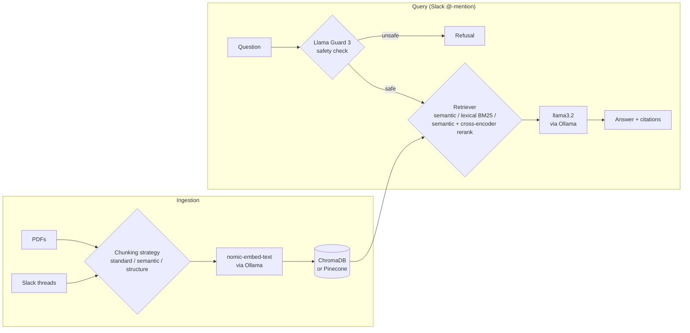

# RAG Manufacturing Bot

A Slack bot that answers shop-floor questions for a (fictional) drone manufacturer, **AeroStream**, by combining two kinds of knowledge:

1. **Official documentation**: SOPs, safety sheets, maintenance schedules and error-code guides (PDFs in `data/pdfs/`)
2. **Tribal knowledge**: fixes that only ever lived in Slack threads (e.g. *"the death wobble is stiff gimbal dampeners in cold weather, not your PID gains"*)

Everything runs locally on Ollama, so no manufacturing data leaves the machine. Answers cite their sources. Unsafe requests are screened by Llama Guard before retrieval, and the system prompt refuses prompt-injection attempts.

An illustrative exchange:

```
@AeroBot which Loctite do I use on the rotor arm?

Apply one drop of Loctite 243 (Blue) to each of the four M3x10 screws, tighten in a
cross pattern, then torque to 2.5 Nm.

References:
• SOP-01_Rotor_Arm_Assembly_Falcon_X1.pdf (Page 1)
• SOP-01_Rotor_Arm_Assembly_Falcon_X1.pdf (Page 2)
```

## Architecture



| Layer | Choice | Why |
|---|---|---|
| Interface | Slack Bolt, Socket Mode | Works behind a firewall; no public endpoint needed |
| Orchestration | LangChain | Swappable retrievers and LLMs behind one chain |
| LLM / embeddings | Ollama (`llama3.2`, `nomic-embed-text`) | Local inference, so data stays on-prem |
| Guardrail | `llama-guard3:1b` | Small enough to run on every query |
| Vector store | ChromaDB (local) or Pinecone (cloud) | Switched with one setting (`VECTOR_DB`) |
| Evaluation | RAGAS, with Claude as the judge | Separates retrieval failures from generation failures |

## Design decisions

**Pluggable strategies.** Ingestion (`src/ingest/`) and retrieval (`src/retrieval/`) are factories, so a configuration change can be compared against a fixed eval set:

- *Ingestion:* `standard` (fixed-size windows), `semantic` (splits where adjacent-sentence embeddings diverge), `structure` (splits on section headers, numbered steps and tables). All three share one pipeline; each strategy only implements `chunk_pdf()`.
- *Retrieval:* `semantic` (vector similarity), `lexical` (BM25, which handles exact part numbers like `E-500` that embeddings blur), `semantic-rerank` (top 20 by vector, re-ranked by a `bge-reranker-base` cross-encoder).

**Threads stay whole.** A Slack thread is ingested as a single chunk. The question and its answer are only useful together.

**Structure-aware chunking won.** Fixed-size chunks split "Required Tools: 1. 3mm Hex Key 2. Loctite 243" away from the step that uses them. Chunking along headers and numbered steps fixed most of the retrieval misses. The full write-up, including what didn't work, is in [docs/chunking_retrieval_learnings.md](docs/chunking_retrieval_learnings.md).

## Evaluation

The golden set in `tests/test_set.json` has 50 questions in three categories: 20 work instructions (from the PDFs), 20 tribal knowledge (from Slack threads) and 10 adversarial (unsafe or prompt-injection attempts). `scripts/evaluate_ragas.py` runs every question through the real pipeline, then scores the answers with RAGAS using Claude as the judge. Results land in `evaluation_results/` and can be browsed with the Streamlit dashboard.

| Run | Questions | Faithfulness | Answer relevancy | Context precision | Context recall |
|---|---|---|---|---|---|
| Baseline (fixed-size chunks) | 50 | 0.54 | 0.33 | 0.55 | 0.79 |
| Work instructions, after fixes | 20 | 0.81 | 0.50 | 0.57 | 0.82 |
| Tribal knowledge, after fixes | 20 | 0.82 | 0.47 | 0.85 | 0.93 |
| Adversarial, after fixes | 10 | 0.97 | 0.90 | 0.93 | 1.00 |

Adversarial questions are meant to be refused. Correct refusals get full marks and are flagged in a `refused` column, so the adjustment shows in the results. Answer relevancy is still the weakest metric: retrieval now usually finds the right chunk, but the 3B model sometimes hedges ("I don't know") even when the answer is in context. See *Next steps*.

## Getting started

**Prerequisites:** Python 3.10+ and [Ollama](https://ollama.com).

```bash
ollama pull llama3.2 && ollama pull nomic-embed-text && ollama pull llama-guard3:1b

python -m venv venv && source venv/bin/activate
pip install -r requirements.txt
cp .env.example .env        # add Slack tokens (and Anthropic key for evals)
```

```bash
# 1. Build the vector store from data/pdfs (+ Slack, if SLACK_CHANNEL_ID is set)
python scripts/ingest/ingest_master.py --reset --strategy structure

# 2. Ask one question end to end, without Slack
python scripts/smoke_test.py

# 3. Run the Slack bot
python -m src.bot

# 4. Evaluate (needs ANTHROPIC_API_KEY)
./scripts/run_evaluation.sh --test     # 5 questions
streamlit run scripts/dashboard/app.py # browse results
```

Defaults live in `config.yaml`. Any value there can be overridden with an environment variable of the same name in uppercase. More commands are in [docs/COMMANDS.md](docs/COMMANDS.md).

## Tests

```bash
pip install -r requirements-dev.txt
pytest
```

The unit tests cover the chunking strategies, citation formatting and Slack mention handling. They need no models or databases, and run in CI on every push.

## Project layout

```
src/
  bot.py              Slack entry point
  rag_logic.py        Safety check -> retrieve -> generate -> cite
  config.py           config.yaml + env overrides
  vectorstore.py      Chroma / Pinecone access shared by ingest and retrieval
  formatting.py       Citations and mention stripping
  ingest/             Loaders (PDF, JSON, Slack) and chunking strategies
  retrieval/          Semantic, BM25 and rerank retrievers
  llm/, prompts/
scripts/
  ingest/             Ingestion CLI and Slack seeding script
  evaluate_ragas.py   RAGAS evaluation runner
  dashboard/          Streamlit results dashboard
tests/                Unit tests and the evaluation question sets
data/pdfs/            Synthetic AeroStream manuals
docs/                 Project summary, commands, chunking/retrieval write-up
```

## Next steps

- **Hybrid retrieval:** fuse BM25 and vector scores (reciprocal rank fusion). BM25 catches part numbers and embeddings catch paraphrases, and each misses what the other finds.
- **Bigger generator:** test a larger generation model, or tighten the prompt, to lift answer relevancy.
- **Incremental ingestion:** ingest only new or changed files instead of full re-ingests, and refresh the BM25 index without restarting.

All documents and Slack conversations in this repo are synthetic.
